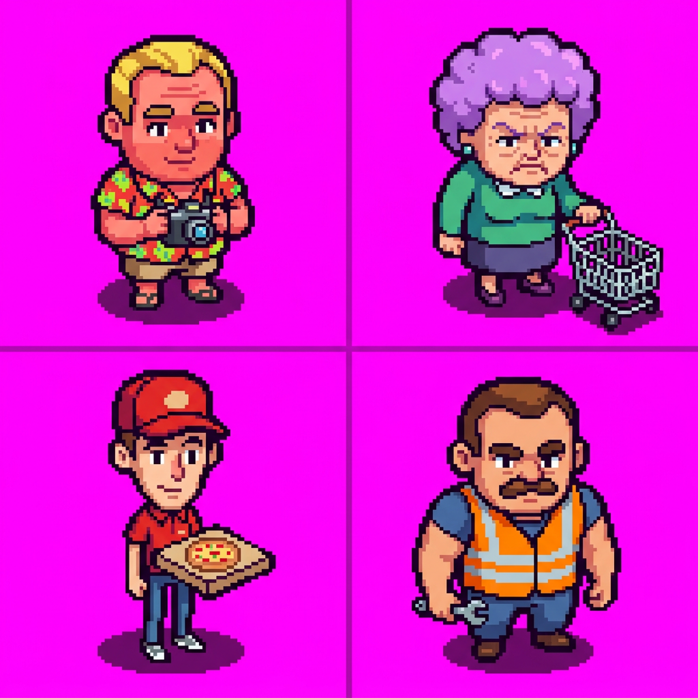
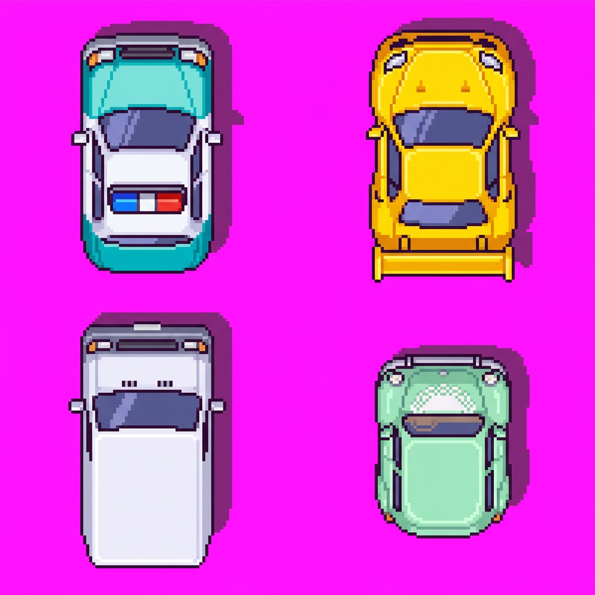
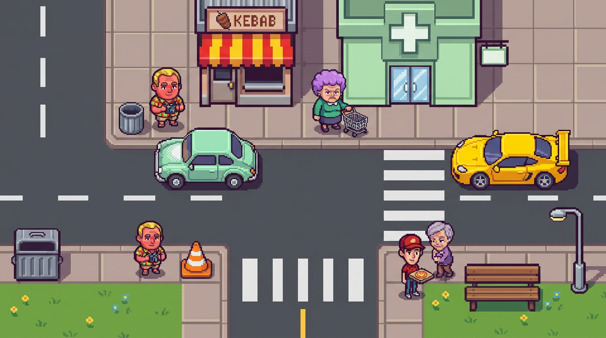

# La bible visuelle

Les 6 planches de référence du jeu. **Elles sont jointes à chaque génération d'image** pour garder un style cohérent (voir [style.md](../style.md), section 8).
Ne pas les modifier sans une décision notée dans `docs/decisions.md` : changer la bible, c'est changer tout le jeu.

| Planche                                | Sert de référence pour          | Prompt                                             | Remarques                                                                                        |
| -------------------------------------- | ------------------------------- | -------------------------------------------------- | ------------------------------------------------------------------------------------------------ |
|  `personnages.png` | tous les sprites de personnages | [prompts/personnages.txt](prompts/personnages.txt) | la référence de départ : générée sans référence, jointe à toutes les autres                      |
|  `portraits.png`     | tous les portraits de dialogue  | [prompts/portraits.txt](prompts/portraits.txt)     |                                                                                                  |
|  `vehicules.png`     | tous les véhicules              | [prompts/vehicules.txt](prompts/vehicules.txt)     | générés nez vers le bas, **tournés de 180°** après coup                                          |
|  `sol.png`                 | toutes les tuiles de sol        | [prompts/sol.txt](prompts/sol.txt)                 | fines bordures entre les cases : `--pad 0.03` les retire                                         |
|  `batiments.png`     | tous les bâtiments et objets    | [prompts/batiments.txt](prompts/batiments.txt)     | 3ᵉ essai (les 2 premiers en vue isométrique) ; la mairie est coupée en deux, à refaire plus tard |
|  `scene.png`             | contrôle global de cohérence    | [prompts/scene.txt](prompts/scene.txt)             | référence seulement : les voitures y sont vues de côté et l'enseigne contient du texte           |

## Quelles planches joindre

| Je génère                              | Je joins                                                              |
| -------------------------------------- | --------------------------------------------------------------------- |
| un personnage, une feuille d'animation | `personnages.png`                                                     |
| un portrait                            | `portraits.png` (+ `personnages.png` si c'est un personnage existant) |
| un véhicule                            | `vehicules.png`                                                       |
| des tuiles                             | `sol.png`                                                             |
| un bâtiment, un objet                  | `batiments.png` + `sol.png`                                           |
| une illustration                       | `scene.png` + `portraits.png`                                         |
