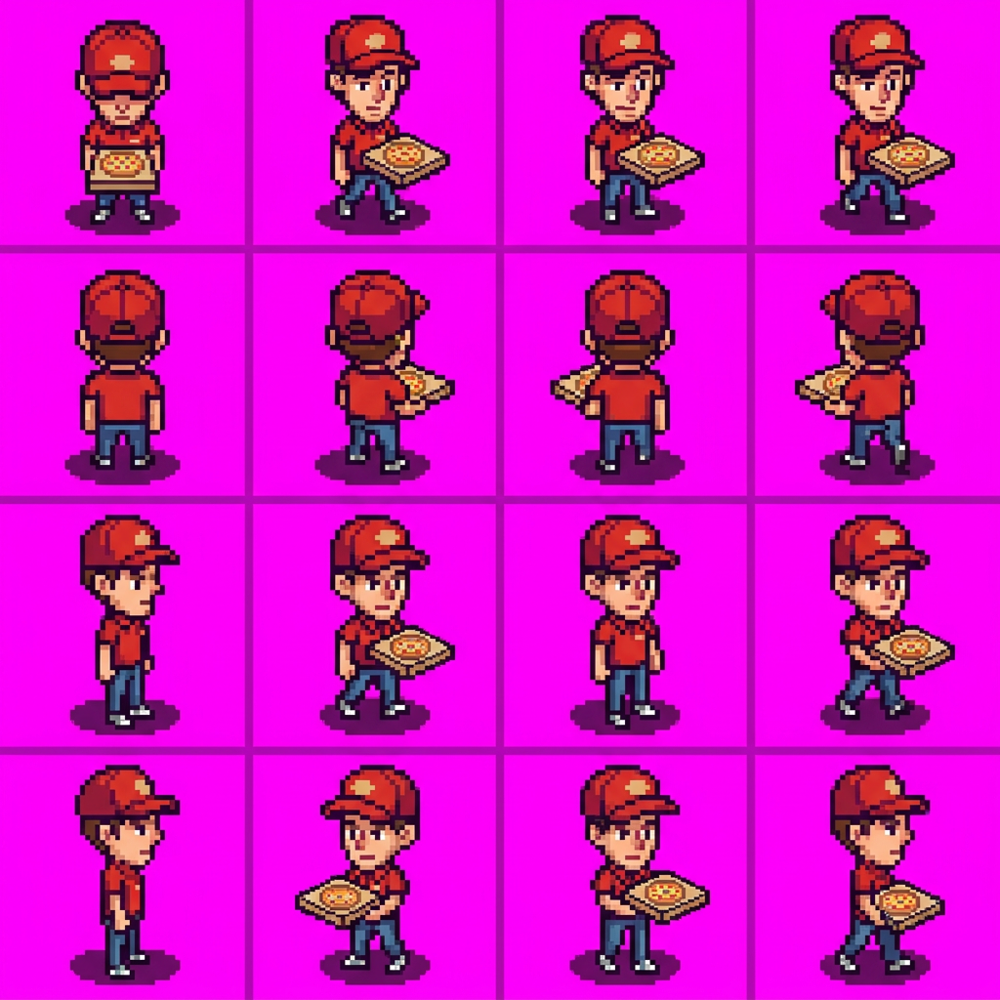
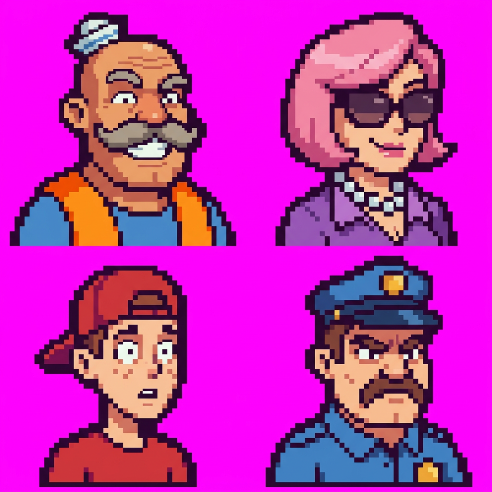
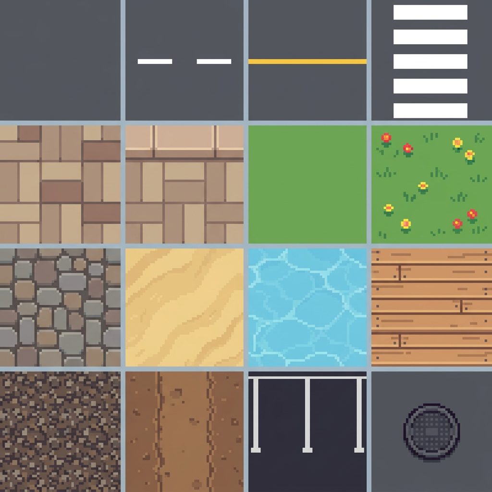
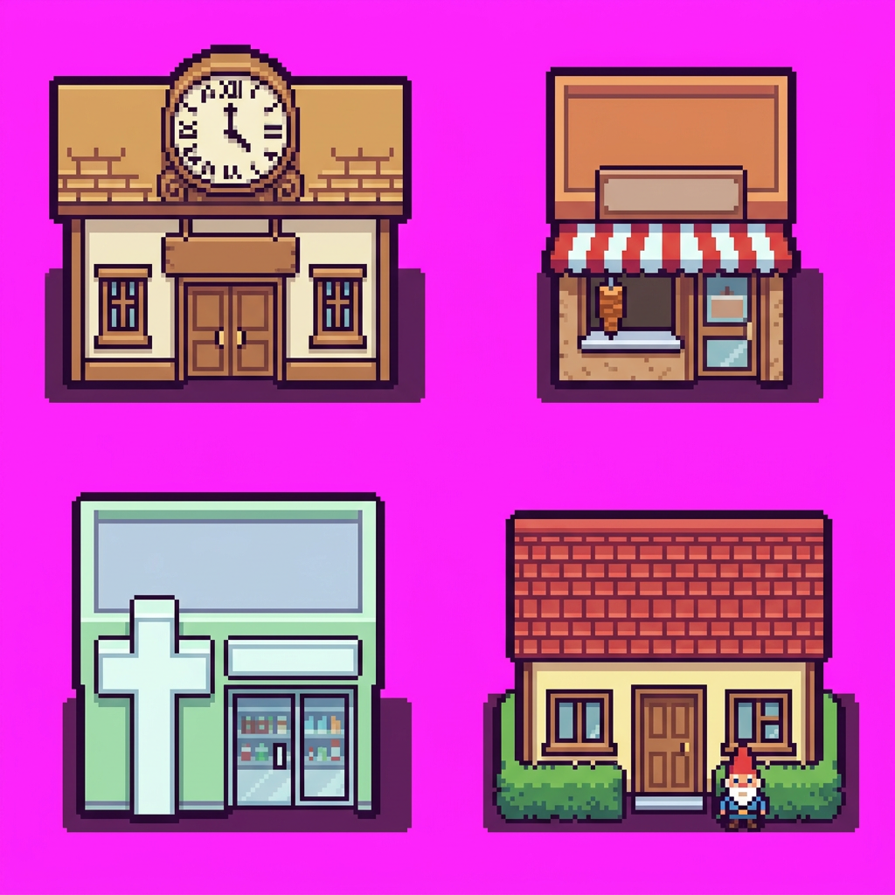

# La bible visuelle

Les planches de référence du jeu, générées avec **Gemini 3 Pro Image**. **Elles sont jointes à chaque génération** pour garder un style cohérent (voir [style.md](../style.md), section 8).
Ne pas les modifier sans une décision notée dans `docs/decisions.md` : changer la bible, c'est changer tout le jeu.

| Planche                                | Sert de référence pour          | Prompt                                             | Remarques                                                                                                                                                                                |
| -------------------------------------- | ------------------------------- | -------------------------------------------------- | ---------------------------------------------------------------------------------------------------------------------------------------------------------------------------------------- |
|  `personnages.png` | tous les sprites de personnages | [prompts/personnages.txt](prompts/personnages.txt) | la référence de départ : générée sans référence, jointe à toutes les autres                                                                                                              |
|  `animation.png`     | les feuilles d'animation        | [prompts/animation.txt](prompts/animation.txt)     | exemple de feuille 4 × 4 : personnage identique sur 16 poses. Défauts connus : la ligne « face » part de biais, la ligne « droite » regarde à gauche (on utilise le miroir de la gauche) |
|  `portraits.png`     | tous les portraits de dialogue  | [prompts/portraits.txt](prompts/portraits.txt)     | contient du violet : pixeliser avec `--cut 120`                                                                                                                                          |
|  `vehicules.png`     | tous les véhicules              | [prompts/vehicules.txt](prompts/vehicules.txt)     | nez vers le haut, vue strictement du dessus                                                                                                                                              |
|  `sol.png`                 | toutes les tuiles de sol        | [prompts/sol.txt](prompts/sol.txt)                 | fines bordures entre les cases : `--pad 0.03` les retire                                                                                                                                 |
|  `batiments.png`     | tous les bâtiments et objets    | [prompts/batiments.txt](prompts/batiments.txt)     | vue de face, alignée sur la grille, sans murs de côté                                                                                                                                    |
|  `scene.png`             | contrôle global de cohérence    | [prompts/scene.txt](prompts/scene.txt)             | référence seulement : les voitures y sont un peu de biais (biais du modèle en scène complète)                                                                                            |

## Quelles planches joindre

| Je génère               | Je joins                                                              |
| ----------------------- | --------------------------------------------------------------------- |
| un personnage           | `personnages.png`                                                     |
| une feuille d'animation | `animation.png` + `personnages.png`                                   |
| un portrait             | `portraits.png` (+ `personnages.png` si c'est un personnage existant) |
| un véhicule             | `vehicules.png`                                                       |
| des tuiles              | `sol.png`                                                             |
| un bâtiment, un objet   | `batiments.png` + `sol.png`                                           |
| une illustration        | `scene.png` + `portraits.png`                                         |

## Historique

Une première bible avait été faite avec Gemini 3.1 Flash Image (moins cher, mais il suivait mal les consignes : bâtiments en isométrique, véhicules à l'envers). Elle a été remplacée le 2026-11-15. Détails dans [registre-visuels.md](../registre-visuels.md).
